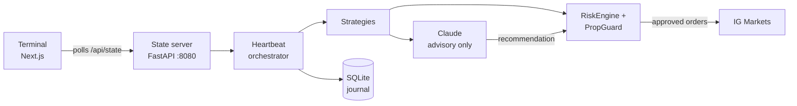

# Apex Algo

**Write a trading strategy in your browser, backtest it on years of local data, and promote it to a live book that can only trade through a hard risk gate.**

<p>
  
  
  
  
</p>

Apex Algo is a trading terminal rather than a single bot. A Next.js dashboard monitors the account and hosts a strategy workspace. A Python engine runs the strategies against IG Markets spread-bet accounts, with a separate bridge for FTMO on MetaTrader 5.

Claude reviews signals and the portfolio and returns structured recommendations, but it has no route to the broker. Python places every order, and every entry has to pass the risk engine first.

> **Risk warning.** Leveraged trading can lose you more than you expect. This software is provided for educational purposes with no warranty. Use a demo account and the backtester first.

## Features

| Area | What it does |
| --- | --- |
| **Live terminal** | Dockable widgets for price charts, watchlist, positions, P&L calendar, risk status, AI usage and cost, and the system log |
| **Strategy editor** | Write per-bar strategies in a sandboxed Python-like language, then save them and select them straight away |
| **Backtester** | Replays strategies over local CSV data with no network calls, checks stops and targets against each bar's high and low, and marks floating equity every bar |
| **Compare** | Overlays strategies on one window, with trade logs and a Monte Carlo estimate of prop-challenge pass and breach probability |
| **Live book** | Promotes a tested strategy to the engine, which trades it under the same risk rules |

## Writing a strategy

A strategy is a short script that runs once per bar and sets `signal`. This is the starter template from the editor:

```python
# name: My Strategy
# description: Describe what this algorithm does

upper, mid, lower = bollinger(20, 2)

if rsi(14) < 30 and close < lower and fear_and_greed < 30:
    signal = "BUY"          # oversold capitulation
elif rsi(14) > 70 and close > upper and fear_and_greed > 75:
    signal = "SELL"         # overbought euphoria
else:
    signal = "HOLD"
```

Scripts can use trend and momentum indicators (`sma`, `ema`, `rsi`, `macd`, `adx`), volatility and range tools (`atr`, `bollinger`, `donchian`), order-flow tools (`vwap`, `volume_profile`, `cvd`, `cvd_divergence`) and regime models (`markov`, `hmm`). They can also read account state such as `day_pnl_pct` and `dd_from_peak_pct`, and set stops, targets, partial exits and trailing stops.

The repo ships a built-in strategy book (EMA trend, RSI reversion and ATR breakout, gated by a regime detector) and one demo written in the language, [Auction Flow](apex/strategies/default/auction_flow.py). Strategies you save in the editor go to `apex/strategies/custom/`, which git ignores.

## How it works



The heartbeat runs independent loops, so a failure in one cannot stop the others:

| Loop | Interval | Job |
| --- | --- | --- |
| Tier 1 | 30 s | Refresh prices and enforce stops and targets, with no AI involved |
| Tier 2 | 5 min | Build candles, run strategies and the regime filter, then apply risk rules and Claude's review |
| Tier 3 | 30 min | Have Claude review the portfolio for early exits and stop trailing |
| Health | 5 min | Watchdog |

The dashboard polls the engine through its `/api/state` route rather than holding a socket open, so it can run on serverless hosts such as Vercel.

## Safety model

- **Risk gate on every entry.** `RiskEngine` checks the kill switch, daily and weekly loss limits, maximum concurrent positions, news blackouts, the market-close buffer, duplicate positions and total open risk. It can reduce a position's size but never increases it.
- **Account-level breaker.** On prop accounts, `PropGuard` samples floating equity every second and flattens everything before a daily or total drawdown limit is reached.
- **AI failure means no trade.** Any Claude error or timeout falls back to `NO_TRADE`, and a master switch turns AI calls off completely.
- **Demo by default.** Live trading needs an explicit environment flag, and `TRADING_ENABLED=false` blocks all new orders.
- **Secrets stay out of the repo.** Credentials live in `.env` or an encrypted onboarding store.

## Getting started

You need Python 3.11+ and Node.js. The backtester works without any broker credentials.

```bash
git clone https://github.com/ADAI-ALEX/apex-terminal.git
cd apex-terminal

# Engine and state server on :8080
python3 -m venv venv
source venv/bin/activate        # Windows: venv\Scripts\activate
pip install -r requirements.txt
cp .env.example .env
python main.py
```

In a second terminal:

```bash
cd dashboard
npm install
cp .env.example .env.local      # set AUTH_SECRET, login details, VPS_URL and VPS_SECRET
npm run dev                     # http://localhost:3000
```

Open the terminal and go to **Algorithms** to backtest straight away. To trade, finish the onboarding wizard with your broker and Anthropic keys and a risk profile; the live heartbeat only starts after that. `start.sh` and `start.bat` automate first-time setup.

Risk limits, markets and strategy parameters are all in [`apex/config.py`](apex/config.py).

## Bundled market data

| Market | Timeframes | Daily history from |
| --- | --- | --- |
| EURUSD | 5m, 15m, 1h, 1D | 2005 |
| FTSE100 | 5m, 15m, 1h, 1D | 2006 |
| XAUUSD | 1D | 2010 |
| US500 | 5m, 15m, 1h, 1D | 2012 |
| NAS100 | 1h, 1D | 2012 |
| BTCUSD | 5m, 15m, 1h, 4h, 1D | 2017 |
| ETHUSD | 5m, 15m, 1h, 4h, 1D | 2017 |

The bundled files run to mid-2026, and intraday history is shorter than daily. The `seed_*` scripts in [`scripts/`](scripts/) rebuild or extend them.

## Project layout

```
apex/
  agents/        Claude signal, portfolio and end-of-day agents
  backtest/      Engine, strategy sandbox and bundled data
  core/          Shared state and the heartbeat
  ig/            IG Markets client
  indicators/    Indicator engine
  journal/       SQLite trade journal
  onboarding/    Encrypted setup store and wizard API
  risk/          RiskEngine and PropGuard
  server/        FastAPI state server
  strategies/    Built-in, demo and user strategies
dashboard/       Next.js terminal
deploy/ftmo-vm/  MetaTrader 5 bridge, VM provisioning and console
docs/            Vercel setup and research notes
scripts/         Data seeding and environment setup
tests/           pytest suite
```

More detail: [running the control plane on Vercel](docs/deploy-vercel.md), [the FTMO deployment](deploy/ftmo-vm/README.md), and the [prop-firm research notes](docs/research/PROP_FIRM_PLAN.md).

## Development

```bash
pytest                              # tests
ruff check .                        # lint
cd dashboard && npx tsc --noEmit    # typecheck the dashboard
```

## License

[MIT](LICENSE) © 2026 Alexander de Gentile-Murnieks
